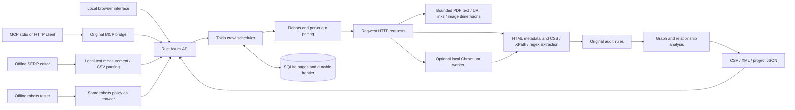

# Independent application architecture

The crawler fetches HTTP URLs concurrently, normalizes URL fragments without
merging arbitrary query variants, and limits request starts per origin. Scope,
robots, include/exclude filters, depth and body limits are checked explicitly.
Default page count is unlimited. Physical memory/disk and user-selected limits
still apply; the current UI/server retains page observations in memory as well
as SQLite. Million-URL throughput and memory scale have not been benchmarked.

SQLite commits a completed page and its discovered links atomically. In-flight
URLs remain pending until their result is committed. A job manifest makes
unfinished crawls visible as interrupted after application restart. Reports and
manifests use temporary-file replacement. Finished reports merge the independent
relationship/security audits before exports and UI retrieval.
Terminal job status becomes visible only after its manifest replacement has
completed. This synchronizes immediate resume; it does not establish power-loss
durability or filesystem fsync behavior.
Loading an existing completed snapshot is read-only: startup preserves stored
JSON bytes, formatting and unknown extension fields. Importing a new report may
derive current analysis and write a new snapshot. Typed API exports can contain
new optional fields; they are separate from the original stored file bytes.

An optional browser worker runs each page in an isolated context. The native
response status remains native; Set-Cookie values are redacted in stored response
headers while other headers retain their observations. DOM metadata, links and custom
extractions use the rendered document, with raw metadata retained separately.
Browser failure is recorded explicitly. Robots-disallowed pages do not invoke
the browser. Browser navigation/subresource traffic has independent timing and
does not claim identical behavior to the HTTP crawler or reference product.

## API surface

| Route | Purpose |
|---|---|
| `GET /healthz`, `/api/capabilities` | Process readiness and implemented/optional capability facts |
| `GET/POST /api/crawls` | Saved jobs / start crawl with `CrawlConfig` |
| `GET /api/crawls/{id}` | Status, warnings, configured scope and counters |
| `GET /api/crawls/{id}/pages?offset=0&limit=200` | Bounded page observations, optional `q` and `internal` |
| `GET /api/crawls/{id}/issues`, `/analysis` | Audit findings and graph/JSON-LD facts |
| `GET /api/crawls/{id}/responses`, `/responses.csv` | Separate native response observations, including intermediate redirects; unretained hop headers/bodies remain unknown |
| `POST /api/crawls/{id}/cancel`, `/resume` | Durable lifecycle control |
| `GET /api/crawls/{id}/export.csv`, `/issues.csv`, `/links.csv`, `/extractions.csv` | Observed page, issue, link and configured extraction exports |
| `GET /api/crawls/{id}/javascript.csv`, `/cookies.csv`, `/pdf.csv`, `/images.csv` | Typed script results, redacted cookie attributes, native PDF observations and fetched image metadata |
| `GET /api/crawls/{id}/fragments`, `/fragments.csv`, `/dom.csv` | Opt-in fragment target checks and source-preserving DOM observations |
| `GET /api/crawls/{id}/sitemap.xml`, `/project.json` | Sitemap candidates / own project snapshot |
| `POST /api/crawls/import` | Import an Open SEO Spider snapshot |
| `GET /api/compare?before={id}&after={id}` | Changes in observed fields between snapshots |
| `POST /mcp` | Stateless Streamable HTTP MCP; GET returns 405 |
| `GET /serp`; `POST /api/serp/preview`, `/import`, `/export.csv` | Offline metadata editing, measurement and CSV parsing; no website requests |
| `GET /robots`; `POST /api/robots/simulate`, `/export.csv` | Bounded supplied-rule evaluation using the crawler matcher; no website requests |

The service is intended for loopback access. Host and browser Origin checks
protect local mutations. Custom crawl headers go only to explicitly configured
seed origins; robots and external requests do not inherit them. The browser
worker separately checks every redirect hop before adding custom headers.
There is no persistent browser login/profile import or provider credential UI.

PDF parsing has a concurrency cap of two, bounded captured input, stream content,
page/object traversal, extracted text and annotation counts. These bounds do not
establish a complete global memory/CPU sandbox inside the parser library. PDF
text coverage is explicit per page; unsupported fonts and Form XObjects produce
partial results with unknown aggregate counts. No OCR or PDF rendering is done.
Image dimensions inspect encoded headers; successful metadata parsing does not
establish complete pixel-decode integrity, animation behavior or EXIF display
orientation. SVG absolute sizing is separate from viewBox and viewport-dependent
or stylesheet-dependent sizes.

DOM facts preserve document order and node paths, explicit hidden/ARIA attributes,
meta keywords, fragment IDs and legacy anchor names. Link locations and configured
CSS position labels are occurrence observations. Responsive image candidates keep
raw URL/descriptors and picture source context separately from any browser network
observation. Nonstandard navigation attributes are potential-navigation facts;
arbitrary JavaScript strings are not guessed to be URLs or added as real anchors.
Collection bounds and absent historical DOM facts remain explicit.

Fragment checks make no additional request and require the target to have been
captured successfully as a complete HTML document. Redirect ambiguity, failures,
limits and absent targets remain unknown. Unsupported media, text directives and
application fragment routing do not become missing-element findings. Validation
must be enabled in the crawl configuration.

## Evidence boundaries

List parsing is a byte-only core operation for UTF-8 TXT/CSV, sitemap XML and
bounded XLSX packages. Streaming Excel cells, actual inflated ZIP/XML budgets
and explicit cached-formula policy avoid dense worksheet allocations and formula
execution. Import results are declared client provenance and are validated before
seeds are derived. CrawlConfig retains original occurrence rows while normal
frontier deduplication controls requests. Sitemap-index inputs enter sitemap
discovery separately from page seeds. `inputs.csv` joins original occurrences to
captured request identities without inventing status for invalid or unfetched
rows. The CLI and HTTP transports share the same parser and validator.

Fragment validation lazily indexes IDs and legacy names for each queried captured
document. Repeated lookups preserve first-DOM-occurrence selection and raw-before-
decoded behavior without rescanning the entire target tree per link.

Deterministic HTTP/API tests prove more than 500 URL observations, cancellation,
resume after process termination, exports, import and comparison. Unit/integration
tests and browser fixture results are retained beside their reproducible scripts.
Graph scores are original PageRank-style calculations. JSON-LD facts are parse
and type observations, not a complete rich-results validator. Axe findings are
automated page checks. Compatibility with proprietary project files, every
reference audit rule, all providers, cross-platform UI behavior, Docker runtime
and million-URL performance remain separate acceptance work.
Linux container build and unprivileged persistent runtime are separately proved
in [CI evidence](verification/resource-offline-ci.json); Windows Docker installation
and a containerized browser worker remain unproved.
